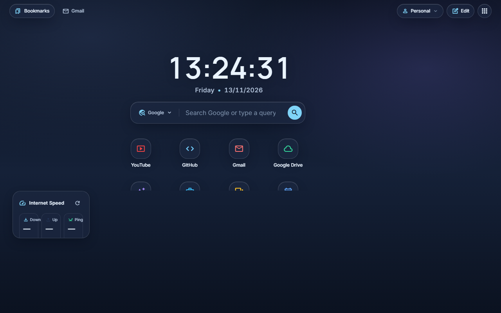
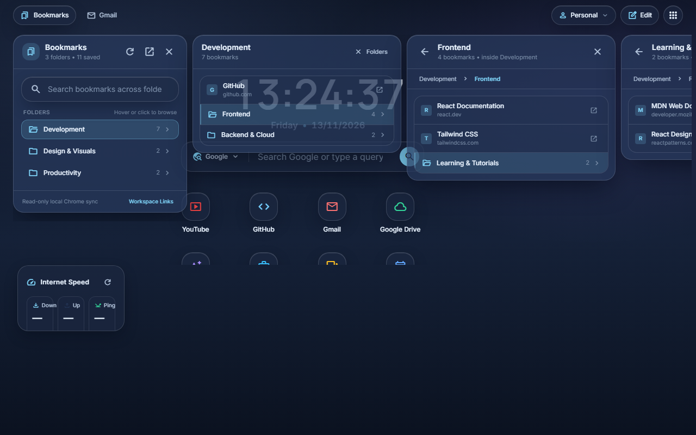
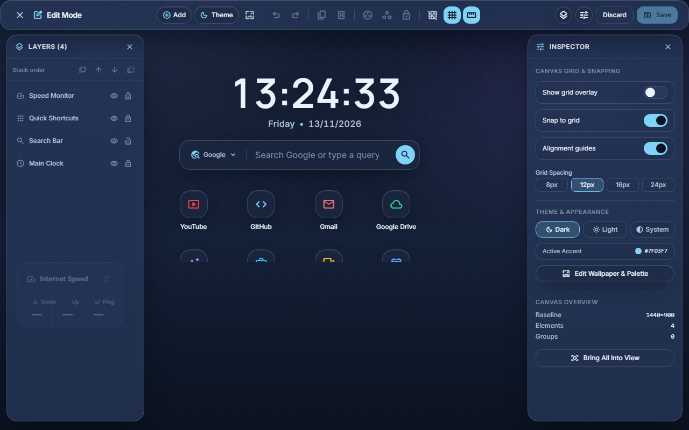
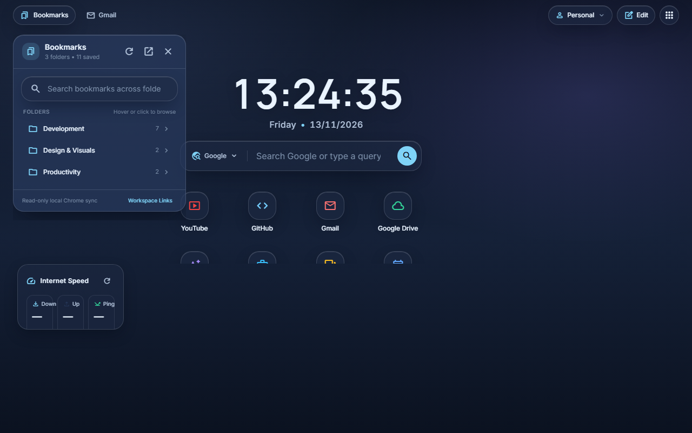
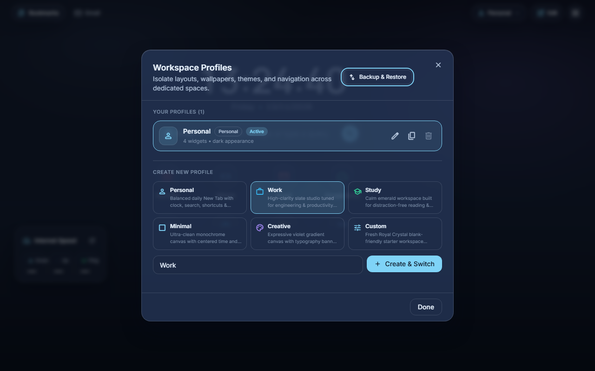
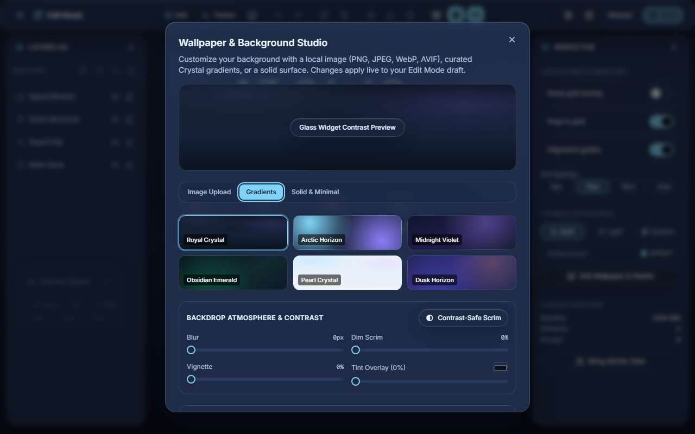
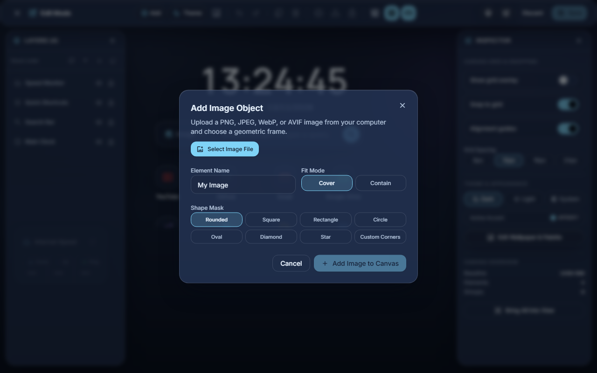

<div align="center">


<p align="center">
  <strong>Your Personal Browser Workspace.</strong><br />
  A high-performance, privacy-first Google Chrome New Tab extension with an interactive canvas engine, recursive nested bookmarks navigation, and real-time internet speed monitoring.
</p>

[](https://github.com/Sanjaycs096/DECKORA/actions/workflows/ci.yml)
[](CHANGELOG.md)
[](LICENSE)
[](https://github.com/Sanjaycs096/DECKORA/stargazers)
[](https://github.com/Sanjaycs096/DECKORA/network/members)
[](https://github.com/Sanjaycs096/DECKORA/issues)
[](https://github.com/Sanjaycs096/DECKORA/commits/main)

[**Quickstart Installation**](#11-installation) • [**Feature Tour**](#4-key-features) • [**Architecture**](#9-architecture-overview) • [**Screenshots**](#7-screenshots-gallery) • [**Changelog**](CHANGELOG.md)

</div>

---

## 1. Hero and Brand Introduction

**DECKORA** reimagines Google Chrome's blank New Tab page into an empowering personal command center. Built from scratch with React 19, TypeScript, and Chrome Extension Manifest V3, DECKORA unites precision spatial layout with the luminous elegance of the Royal Crystal design system.

> **Chrome MV3 Scope Notice:** In accordance with Google Chrome Manifest V3 extension boundaries (`chrome_url_overrides.newtab`), DECKORA operates strictly within the page viewport of newly opened tabs. It does not alter Chrome's native browser frame, address omnibox, or operating system window decorations.

---

## 2. Product Overview

Traditional new tab extensions force you into rigid grid templates or collect tracking data on every click. **DECKORA is local-first, privacy-respecting, and completely customizable**:

- **Dual-Mode Workflow:** Toggle seamlessly between focused, clean **Browse Mode** and comprehensive **Master Edit Mode**.
- **Interactive Freeform Canvas:** Drag, resize, align, and group widgets on a sub-pixel layout grid with magnetic snapping guides.
- **Hierarchical Bookmarks:** Browse your entire Chrome bookmark collection through recursive cascading hover flyouts down to any depth.
- **Real-Time Network Diagnostics:** Measure download speed, upload speed, ping latency, and jitter with on-demand testing.
- **Isolated Workspace Profiles:** Maintain separate workspaces for Personal, Work, Research, and Creative focus contexts.
- **Zero Remote Dependencies:** Zero tracking analytics, zero external CDNs, and zero cloud accounts. All data resides safely on your device.

---

## 3. Main Workspace Preview

<div align="center">
  
  <p><em>DECKORA default New Tab workspace in Royal Crystal dark theme featuring live clock, multi-engine search, quick shortcuts, and speed monitor widget.</em></p>
</div>

---

## 4. Key Features

- **Spatial Freeform Canvas:** Position any widget anywhere on screen. Supports marquee multi-selection, alignment guides, depth layering, and locking.
- **Transactional History Engine:** Full undo/redo (`Ctrl+Z` / `Ctrl+Y`) transaction stack with atomic Save vs. Discard confirmation dialogs.
- **Recursive Cascading Bookmarks:** Left-docked folder sidebar with cascading hover flyouts, breadcrumb jumps, and keyboard navigation.
- **Smart Multi-Engine Search:** Switch between Google, DuckDuckGo, and Bing with instant `/` key focus and local suggestion history.
- **Customizable Shortcuts Grid:** Flexible 8-slot quick link deck with automatic high-resolution favicon resolution via Chrome's native favicon provider.
- **Internet Speed Monitor:** Client-side network measurement powered by bounded Cloudflare CDN endpoints with zero telemetry.
- **Media & Custom Text Objects:** Upload images, animated GIFs, or typography cards stored securely in browser IndexedDB.
- **Wallpaper & Background Studio:** Curated Royal Crystal gradients, custom solid palettes, backdrop blur, dim scrims, and vignette overlays.
- **Multi-Profile Management:** Create, duplicate, and switch across unlimited workspace profiles (Personal, Work, Study, Minimal, Creative, Custom).
- **Portable JSON/ZIP Backup:** One-click export and import of `.deckora-bundle.zip` files with magic-byte security inspection.

---

## 5. Nested Bookmarks Demonstration

<div align="center">
  
  <p><em>Recursive cascading folder navigation across multiple nested levels (Development → Frontend → Learning & Tutorials) with active breadcrumb tracking and keyboard accessibility.</em></p>
</div>

### Recursive Navigation Highlights

- **Arbitrary Depth:** Navigate deep folder hierarchies without artificial level limits.
- **Smooth Pointer Bridges:** Intelligent grace timers prevent flyouts from closing during diagonal mouse movement.
- **Sibling Hover Switching:** Hovering a sibling immediately swaps the active branch without leaving ghost panels.
- **Keyboard & Touch Ready:** Full support for `ArrowRight`, `ArrowLeft`, `Enter`, `Escape`, and mobile touch taps.
- **Privacy First:** If optional Chrome `bookmarks` permission is not granted, DECKORA maintains local curated profile links.

---

## 6. Edit Mode Demonstration

<div align="center">
  
  <p><em>Master Edit Mode with top editing toolbar, canvas transformation bounding boxes, Layers panel (left), and Properties Inspector (right).</em></p>
</div>

### Edit Mode Capabilities

- **Direct Manipulation:** Drag widgets freely or resize with proportional corner handles.
- **Layers Panel:** Inspect visual z-index stack, toggle element visibility, and lock background elements from accidental edits.
- **Inspector Panel:** Configure sub-pixel grid spacing (8px, 12px, 16px, 24px), toggle alignment guides, and manage themes.
- **Safety First:** Unsaved changes prompt an explicit Discard/Save confirmation before exiting.

---

## 7. Screenshots Gallery

<div align="center">

|                                     Bookmarks Drawer                                     |                                    Workspace Profiles                                    |
| :--------------------------------------------------------------------------------------: | :--------------------------------------------------------------------------------------: |
|   |  |
|                            **Wallpaper & Appearance Studio**                             |                              **Add Image & Media Elements**                              |
|  |         |

</div>

---

## 8. Technology Stack

- **Platform:** Google Chrome Extension Manifest V3 (`chrome_url_overrides.newtab`)
- **Core Framework:** React 19, TypeScript 5.9 (Strict mode enabled)
- **Bundler & Tooling:** Vite 8, Rollup, PostCSS
- **Styling Architecture:** Tailwind CSS v4, CSS Variables, Royal Crystal design tokens
- **UI Components:** Radix UI primitives (`@radix-ui/react-dialog`, `@radix-ui/react-dropdown-menu`, `@radix-ui/react-slider`, `@radix-ui/react-switch`, `@radix-ui/react-tabs`, `@radix-ui/react-tooltip`)
- **Iconography:** Google Material Symbols Rounded (`@fontsource-variable/material-symbols-rounded`) exclusively
- **Typography:** Inter Variable (`@fontsource-variable/inter`), Manrope Variable (`@fontsource-variable/manrope`)
- **State & Immutability:** Zustand 5, Immer 10
- **Schema Validation:** Zod 4
- **Client Storage:** IndexedDB (`idb` v8) and Chrome Storage API (`@types/chrome`)
- **Quality & Testing:** Vitest 4, `@testing-library/react`, ESLint 9, Prettier 3

---

## 9. Architecture Overview

```
┌────────────────────────────────────────────────────────────────────────┐
│                        Google Chrome Browser                          │
│                                                                        │
│   ┌────────────────────────────────────────────────────────────────┐   │
│   │                      DECKORA New Tab View                      │   │
│   │                                                                │   │
│   │  ┌──────────────────── TopNavigation ───────────────────────┐  │   │
│   │  │ [Bookmarks] [Gmail]        [Profiles] [Edit] [GoogleApps]│  │   │
│   │  └──────────────────────────────────────────────────────────┘  │   │
│   │                                                                │   │
│   │  ┌───────────────── WorkspaceViewCanvas ────────────────────┐  │   │
│   │  │   [LiveClock]       [SearchBar]       [ShortcutsGrid]    │  │   │
│   │  │   [SpeedMonitor]    [Image/Gif]       [TextElements]     │  │   │
│   │  └──────────────────────────────────────────────────────────┘  │   │
│   └────────────────────────────────┬───────────────────────────────┘   │
│                                    │                                   │
│                        Zustand Reactive State                          │
│          (workspaceStore, editorSessionStore, preferencesStore)         │
│                                    │                                   │
│                   ┌────────────────┴────────────────┐                  │
│                   ▼                                 ▼                  │
│      ┌─────────────────────────┐       ┌─────────────────────────┐     │
│      │   chrome.storage.local   │       │   IndexedDB (idb)       │     │
│      │  (Layouts, JSON configs)│       │  (Binary blobs & media) │     │
│      └─────────────────────────┘       └─────────────────────────┘     │
│                                                     ▲                  │
│   ┌────────────────────────────────┐                │                  │
│   │   Background Service Worker    │────────────────┘                  │
│   │   (Alarms & Speed Scheduler)   │ (Scheduled network tests)         │
│   └────────────────────────────────┘                                   │
└────────────────────────────────────────────────────────────────────────┘
```

1. **View Layer:** Declarative React 19 tree rendered within standard browser frame boundaries.
2. **Session Isolation:** `editorSessionStore` clones workspace state into an active editing draft, ensuring in-flight adjustments never corrupt persistent data until committed.
3. **Storage Tiering:**
   - `chrome.storage.local`: Fast JSON storage for workspace metadata and layout configurations.
   - `IndexedDB` (`aurora-assets-db`): High-capacity local binary storage for wallpapers, uploaded pictures, and animated GIFs.

---

## 10. Project Structure

```
DECKORA/
├── .github/                            # CI workflows and community templates
│   ├── ISSUE_TEMPLATE/                 # Structured bug and feature templates
│   ├── workflows/ci.yml                # GitHub Actions test and verification pipeline
│   └── PULL_REQUEST_TEMPLATE.md        # Pull request guidelines
├── docs/                               # Architecture decision records and phase reports
│   ├── reports/                        # Milestone implementation reports
│   └── screenshots/                    # High-resolution product screenshots
├── public/                             # Extension runtime static assets
│   ├── brand/                          # Brand logos, symbols, and promotional banners
│   ├── fonts/                          # SIL Open Font & Apache 2.0 license documents
│   ├── icons/                          # 16, 32, 48, 128px PNG extension icons
│   └── manifest.json                   # Chrome Extension Manifest V3 configuration
├── src/                                # Application source code
│   ├── app/                            # Top-level React App root & integration tests
│   ├── background/                     # MV3 background service worker & alarms scheduler
│   ├── components/                     # Reusable UI primitives & brand components
│   │   ├── brand/                      # DECKORA Logo & About modal
│   │   ├── shared/                     # Canvas background, MaterialSymbol, error boundary
│   │   └── ui/                         # Buttons, Dialogs, Dropdowns, Inputs, Sliders, Tabs
│   ├── design-system/                  # Royal Crystal color tokens & theme engine
│   ├── features/                       # Modular feature domains
│   │   ├── bookmarks/                  # Recursive drawer, cascading flyouts, Chrome sync
│   │   ├── clock/                      # Live digital clock, formatting, and time hooks
│   │   ├── editor/                     # Canvas stage, toolbar, layers, inspector, snapping
│   │   ├── elements/                   # Image, GIF, text rendering and creation dialogs
│   │   ├── navigation/                 # 5-control top navigation bar & Google Apps launcher
│   │   ├── portability/                # ZIP bundle exporter/importer & validation
│   │   ├── profiles/                   # Multi-profile manager and preset templates
│   │   ├── search/                     # Multi-engine search bar & suggestion integration
│   │   ├── shortcuts/                  # Quick links grid, modal editor, and favicon loader
│   │   ├── speed/                      # Bounded Cloudflare speed test engine & widget
│   │   ├── theme/                      # Adaptive wallpaper color extraction & palette generator
│   │   └── wallpaper/                  # Wallpaper manager & solid/gradient/image picker
│   ├── hooks/                          # Shared React hooks (asset URLs, font/theme sync)
│   ├── security/                       # Automated security verification tests
│   ├── services/                       # Data layer services
│   │   ├── assets/                     # IndexedDB binary asset storage & magic-byte validator
│   │   └── storage/                    # chrome.storage adapter & Zod validation schemas
│   ├── state/                          # Zustand global state stores (workspace, editor, theme)
│   ├── styles/                         # Global Tailwind styles & font imports
│   ├── test/                           # Vitest setup & testing mocks
│   ├── types/                          # TypeScript workspace data contracts
│   └── utils/                          # DOM utilities, Classnames (cn), URL protocol sanitizer
├── CHANGELOG.md                        # Keep a Changelog documentation
├── CONTRIBUTING.md                     # Contribution guidelines and workflow rules
├── LICENSE                             # MIT Open Source License
├── package.json                        # Node dependencies and project scripts
├── pnpm-lock.yaml                      # Deterministic pnpm dependency lockfile
├── README.md                           # Comprehensive product and technical documentation
└── SECURITY.md                         # Responsible disclosure and security policy
```

---

## 11. Installation

Ensure your development environment meets the following requirements:

- **Node.js:** `v20.18.0` or `v22.x+` (verified on Node `v24.12.0`)
- **Package Manager:** `pnpm` `v9.x` or `v10.x` (verified on `v10.29.3`)
- **Browser:** Google Chrome or any Chromium-based browser supporting Manifest V3

---

## 12. Development Setup

```bash
# 1. Clone the repository
git clone https://github.com/Sanjaycs096/DECKORA.git
cd DECKORA

# 2. Install dependencies with strict frozen lockfile
pnpm install --frozen-lockfile

# 3. Start local development server
pnpm dev
```

Visit `http://localhost:5173/newtab.html` to preview and develop UI components directly in your browser.

---

## 13. Chrome Extension Installation

To run DECKORA as an active Chrome Extension:

1. Build the production bundle:
   ```bash
   pnpm build
   ```
2. Open Google Chrome and navigate to `chrome://extensions/`.
3. Enable **Developer mode** toggle in the top-right corner.
4. Click **Load unpacked** in the top-left toolbar.
5. Select the **`dist`** directory inside the `DECKORA` repository.
6. Open a new tab (`Ctrl+T` or `⌘T`) to experience DECKORA!

---

## 14. Permissions and Privacy

DECKORA strictly observes least-privilege extension architecture:

| Permission                       | Scope        | Justification                                                                                                         |
| :------------------------------- | :----------- | :-------------------------------------------------------------------------------------------------------------------- |
| `storage`                        | Required     | Persisting workspace layouts, widget positions, and profile settings locally in `chrome.storage.local`.               |
| `favicon`                        | Required     | Resolving high-resolution shortcut icons via Chrome's internal `chrome://favicon2/` cache with zero external queries. |
| `alarms`                         | Required     | Scheduling periodic background speed checks when enabled by the user.                                                 |
| `bookmarks`                      | **Optional** | Reading Chrome bookmarks tree for the Bookmarks flyout. If denied, local curated links are used.                      |
| `https://speed.cloudflare.com/*` | **Optional** | Bounded endpoints queried exclusively during user-authorized speed tests.                                             |

- **Zero Tracking:** No analytics libraries, remote telemetry, or user tracking.
- **Zero Cloud Storage:** Your bookmarks, shortcuts, and personal notes never leave your computer.

---

## 15. Workspace Backup / Import / Export

Protect your personalized workspace with portable `.deckora-bundle.zip` archives:

- **Export:** Packages active layouts, profile definitions, and local media into a compressed archive.
- **Import Verification:** Inspects magic bytes (PNG, JPEG, WebP, AVIF, GIF), validates uncompressed size caps (< 50 MB), and protects against path traversal (Zip Slip) attacks before extraction.
- **Backward Compatibility:** Seamlessly restores older `.aurora-bundle.zip` archives.

---

## 16. Testing and CI

The repository is protected by comprehensive automated test suites:

```bash
# Run unit, integration, and security tests
pnpm test

# Run code style check
pnpm format:check

# Run TypeScript compiler typecheck
pnpm typecheck

# Run ESLint analysis
pnpm lint

# Production vulnerability audit
pnpm audit --prod
```

GitHub Actions executes the complete quality pipeline on every push and pull request to `main`.

---

## 17. Roadmap

- [ ] **Interactive Widget Expansions:** Embedded to-do lists, scratchpad sticky notes, and weather reports.
- [ ] **Canvas Presets Library:** One-click pre-arranged dashboard templates.
- [ ] **Custom Shader Backdrops:** Optional subtle ambient canvas animations.
- [ ] **Keyboard Canvas Navigation:** Comprehensive arrow-key navigation across canvas objects in View Mode.

---

## 18. Contribution Guide

Contributions from the open-source community are warmly welcomed! Please read [CONTRIBUTING.md](CONTRIBUTING.md) for details on code style, branch naming conventions, TypeScript standards, and pull request verification.

---

## 19. Security Policy

Security is paramount in DECKORA. Please consult [SECURITY.md](SECURITY.md) for information on our responsible disclosure policy, supported versions, and how to report vulnerabilities.

---

## 20. License and Maintainer

DECKORA is open-source software licensed under the **[MIT License](LICENSE)**.

- **Author & Maintainer:** [SANJAYKUMAR M](https://github.com/Sanjaycs096)
- **Repository:** [https://github.com/Sanjaycs096/DECKORA](https://github.com/Sanjaycs096/DECKORA)
- **Issues & Support:** [https://github.com/Sanjaycs096/DECKORA/issues](https://github.com/Sanjaycs096/DECKORA/issues)

Copyright © 2026 SANJAYKUMAR M. All rights reserved.
