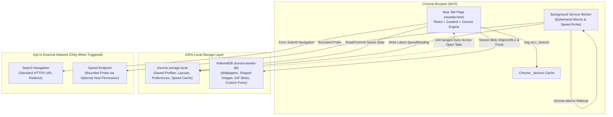
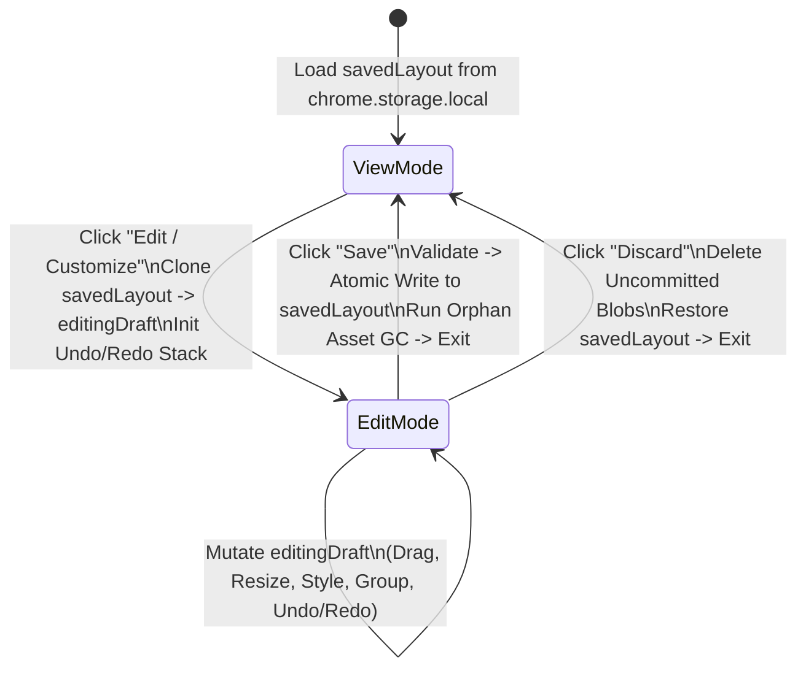

# PHASE 0 — Technical Architecture

**Product:** AURORA — Your Personal Browser Workspace  
**Target Platform:** Chrome Extension Manifest V3 (MV3)  
**Architecture Style:** Local-First Modular SPA + Ephemeral MV3 Service Worker  

---

## 1. Technology Stack & Justifications

| Layer | Choice | Justification |
|---|---|---|
| **Runtime / UI** | **React 18/19 + TypeScript (Strict)** | Predictable component isolation, strong static typing for complex canvas/editor schemas, rich ecosystem. |
| **Styling** | **Tailwind CSS + CSS Custom Properties** | Rapid Royal Crystal token utility classes combined with runtime CSS variables (`--aurora-*`, `--glass-*`) for zero-rebuild dynamic theming and custom user accents. |
| **UI Primitives** | **shadcn/ui (Radix UI) + Preline patterns** | Accessible keyboard-navigable dialogs, sliders, popovers, and tabs owned directly in-repo. **All default `lucide-react` imports must be replaced with `<MaterialSymbol />`.** |
| **Icons** | **Google Material Symbols (Bundled WOFF2 / SVG)** | Exclusive icon system per product mandate; locally bundled to comply with MV3 CSP and guarantee offline rendering. |
| **State Management** | **Zustand + Immer** | Minimal bundle overhead, selector-based fine-grained subscriptions (crucial so clock/drag updates never rerender unrelated widgets), clean separation of `savedWorkspace` vs `editorDraft`. |
| **IndexedDB Wrapper** | **`idb` (lightweight promise wrapper)** | Clean TypeScript transactions for storing multi-megabyte wallpapers, images, animated GIF blobs, and custom font binaries. |
| **Build Tooling** | **Vite + `@crxjs/vite-plugin` (or multi-entry Vite MV3 build)** | Fast HMR during UI development, deterministic production bundle splitting (`newtab.html`, `background.js`), zero eval/unsafe-inline output for MV3 CSP. |
| **Validation** | **Zod** | Runtime schema validation for imported `.aurora.json` profiles, storage migrations, and corrupt-snapshot recovery. |
| **Testing** | **Vitest + React Testing Library + Playwright** | Fast unit/integration verification in Vitest; real unpacked-extension Chromium E2E testing in Playwright. |

---

## 2. Chrome Extension Manifest V3 Architecture

### 2.1 Entry Points
1. **`newtab.html` (`chrome_url_overrides.newtab`)**: Primary React application rendered immediately on every New Tab.
2. **`src/background/service-worker.ts` (`background.service_worker`, `type: "module"`)**: Lightweight ephemeral MV3 service worker handling:
   - `chrome.runtime.onInstalled` (initial schema seeding / version migrations).
   - `chrome.alarms` for periodic speed checks *only while Chrome is running* (minimum >= 1 minute; default 30 min or manual).
   - Optional background speed-probe execution and caching the latest `SpeedReading` into `chrome.storage.local` so newly opened tabs display fresh metrics immediately.
3. **`_favicon/` Virtual Endpoint**: Built-in Chrome MV3 favicon resolver (`chrome-extension://<EXT_ID>/_favicon/?pageUrl=...&size=64`).

### 2.2 Least-Privilege Permission Strategy

| Permission | Classification | Justification |
|---|---|---|
| `storage` | Required | Persist saved layouts, profiles, theme settings, and cached speed readings in `chrome.storage.local`. |
| `favicon` | Required | Resolve site icons locally via Chrome's `_favicon` API without requesting `<all_urls>` host permissions. |
| `alarms` | Required | Schedule conservative periodic internet speed tests while Chrome is running. |
| `bookmarks` | **Optional (`optional_permissions`)** | Requested **only** if user enables "Sync Chrome Bookmarks Bar" in the top nav; default curated bookmarks need zero permission. |
| `search` | **Optional (`optional_permissions`)** | Optionally used if user selects "Use Browser Default Search Engine" via `chrome.search.query`. |
| `https://speed.cloudflare.com/*` (or user-defined probe URL) | **Optional (`optional_host_permissions`)** | Requested via `chrome.permissions.request()` when the user enables the Internet Speed Widget's active measurements. Keeps initial install warning footprint minimal and transparent. |

> **Explicitly Omitted Permissions:** No `<all_urls>`, no `tabs`, no `history`, no `cookies`, no `scripting`, no `identity`.

---

## 3. High-Level System Architecture

### Multi-Tab Synchronization
When a user clicks **Save** in Tab A's Master Edit Mode, `chrome.storage.local` updates the active profile and increments `revision`. Tab B (already open in the background) listens to `chrome.storage.onChanged` and—if Tab B is *not* currently in Master Edit Mode—updates cleanly to reflect the newly committed layout.

---

## 4. Storage & Asset Management Architecture

### 4.1 Storage Split Rationale
- **`chrome.storage.local` (JSON metadata & settings):** Fast async key-value store (~10 MB default quota, or expandable with `unlimitedStorage` if ever needed, though metadata stays < 500 KB). Holds profiles, layout trees, theme tokens, widget configurations, and last speed reading.
- **`chrome.storage.sync` (Not used as primary store):** Limited to 100 KB total / 8 KB per item. Never suitable for rich layouts or binary assets. May be considered in v1.1 for tiny user-preference flags only.
- **`IndexedDB` (`aurora-assets-db`):** Stores raw `Blob` / `ArrayBuffer` assets keyed by content-addressed or UUID `assetId` (`wallpapers`, `images`, `gifs`, `fonts`), avoiding base64 string bloat in JSON.

### 4.2 Asset Validation & Ingestion Pipeline
Every uploaded file passes a strict local validation pipeline before entering IndexedDB:
1. **Size Gate:** Enforce safe per-asset caps (e.g., Wallpapers <= 15 MB, Images <= 10 MB, Animated GIFs <= 15 MB, Fonts <= 8 MB) with clear user feedback.
2. **Magic-Byte Signature Sniffing:** Read initial file bytes (`Uint8Array`)—**never** trust `file.name` or `file.type` alone:
   - PNG: `89 50 4E 47`
   - JPEG: `FF D8 FF`
   - WebP: `RIFF....WEBP`
   - GIF: `47 49 46 38 37 61` (`GIF87a`) or `47 49 46 38 39 61` (`GIF89a`)
   - WOFF2: `77 4F 46 32` (`wOF2`), WOFF: `77 4F 46 30` (`wOFF`), TTF: `00 01 00 00`, OTF: `4F 54 54 4F` (`OTTO`)
   - **SVG Policy:** Disallow arbitrary SVG uploads into ``/inline DOM unless explicitly sanitized or rasterized, OR restrict Phase 1–4 image uploads to raster formats + GIF to eliminate SVG embedded `<script>` XSS risks (documented in ADR-003).
3. **Format-Specific Handling:**
   - **Wallpapers & Shaped Images:** Optionally decode dimensions via `createImageBitmap` to capture natural width/height and compute wallpaper palette (quantized 5-color palette + relative luminance) offscreen without altering the stored blob.
   - **Animated GIFs:** Bypass canvas re-encoding completely. Store the exact original `image/gif` `Blob` in IndexedDB so all frames, delays, and loop counts remain 100% intact.
   - **Custom Fonts:** Load via `new FontFace(family, arrayBuffer)` inside a try/catch; only persist to IndexedDB if `await fontFace.load()` succeeds cleanly.
4. **ObjectURL Lifecycle & Garbage Collection:**
   - AssetLoader maintains a reference-counted cache (`Map<assetId, { url, refCount }>`), revoking `URL.createObjectURL` only when no mounted view or draft references it.
   - **Two-Phase Orphan GC:** Assets uploaded during an editing session are tagged `pending` or tracked in draft. Clicking **Discard** immediately deletes newly uploaded uncommitted assets; clicking **Save** runs mark-and-sweep across all saved profiles to purge unreferenced blobs from IndexedDB.

---

## 5. Layout & Canvas Coordinate Engine

A fixed-pixel layout breaks across `1366×768` laptops and `2560×1440` monitors, whereas pure percentage sizing distorts widget aspect ratios (e.g., making a circular photo into an ellipse or crushing a search bar).

### 5.1 Recommended Strategy: Hybrid Anchor-Percent + Reference-Scaled Frame
AURORA uses a **Normalized Workspace Frame** (`anchor` + percentage `xPct`/`yPct` position + reference-pixel `width`/`height` with aspect-aware scaling and viewport clamping):

- **Position (`xPct`, `yPct`):** Stored as percentages (`0.0` to `100.0`) of the **Safe Canvas Area** (viewport minus Top Navigation safe strip), referencing the element's top-left or center anchor. This preserves proportional spatial composition across aspect ratios.
- **Dimensions (`widthPx`, `heightPx`):** Stored relative to a canonical `1440×900` reference baseline (or explicit pixel dimensions with an optional `scaleMode`: `fixed` vs `responsive-clamp`), constrained by per-element `minWidth`/`minHeight` and `maxWidth`/`maxHeight` so typography and widgets never collapse into unreadable slivers.
- **Off-Viewport Clamping & Recovery:** On resize or smaller laptop screens, a runtime `clampToViewport(rect, safeBounds)` pass guarantees every visible element keeps at least a `32px` grab/interaction margin inside the viewport (non-destructively at render time—without mutating the user's saved ultra-wide coordinates!). An editor action **"Bring All Offscreen Elements Into View"** also exists in Master Edit Mode.
- **Browser Zoom Behavior:** Because Chrome scales CSS pixels uniformly with browser zoom (`devicePixelRatio` changes), CSS-pixel layout + percentage canvas coordinates scale predictably without JavaScript zoom hacks.

### 5.2 Snapping, Guides & Collision Policy
- **Snap-to-Grid:** Optional configurable grid (`8px`, `12px`, `16px`, `24px`); during drag/resize, pointer delta snaps cleanly when grid snap is active (`Alt` temporarily bypasses snap).
- **Magnetic Alignment Guides:** Computes horizontal/vertical candidate lines for canvas center (`50%`), safe margins, and sibling bounding-box edges/centers (`left`, `centerX`, `right`, `top`, `centerY`, `bottom`) within a `6px` magnetic threshold, rendering crisp `1px` Royal Violet (`#A78BFA`) guide lines during drag.
- **Collision Behavior:** Freeform overlapping is **allowed** (essential for layered creative compositions with images, GIFs, text, and z-index ordering). Z-order is managed explicitly via `zIndex` normalization (`0..N-1`).

### 5.3 Group Transformations
- A `Group` element stores `childIds: string[]` (or elements store `groupId: string | null`) and computes a live union bounding box `getGroupBounds(children)`.
- Dragging a group translates all children by identical `ΔxPct, ΔyPct`.
- Resizing a group scales each child's relative offset and dimensions proportionally around the group's opposite anchor handle, respecting child minimum bounds.

---

## 6. Master Edit Mode & Transactional State Engine

### 6.1 Undo / Redo Command Architecture
- Implemented via an immutable snapshot ring/history stack (via Immer patches or structural snapshots, capped at `75` history entries).
- **Continuous Drag/Resize Coalescing:** Pointer `pointerdown` captures `beforeSnapshot`; `pointermove` updates transient local drag state at 60 fps without pushing 200 history entries; `pointerup` commits a single atomic history entry!

### 6.2 All 20 Required Operations Supported
1. Select single (`Click`)
2. Drag & reposition (Pointer drag + Arrow nudge)
3. Resize via 8-point handles (`N, NE, E, SE, S, SW, W, NW`; `Shift` locks aspect ratio)
4. Multi-select (`Shift+Click` & marquee drag rectangle)
5. Group (`Ctrl+G`)
6. Ungroup (`Ctrl+Shift+G`)
7. Duplicate (`Ctrl+D`)
8. Delete (`Delete` / `Backspace`)
9. Lock / Unlock
10. Stacking order: Bring to Front (`Ctrl+]`), Send to Back (`Ctrl+[`)
11. Bring Forward (`]`)
12. Send Backward (`[`)
13. Align objects (Left, Center H, Right, Top, Middle V, Bottom)
14. Distribute objects (Horizontal, Vertical — requires >= 3 selected items)
15. Snap-to-grid
16. Magnetic alignment guides
17. Copy & Paste (`Ctrl+C` / `Ctrl+V` with `+24px` cascade offset)
18. Undo (`Ctrl+Z`)
19. Redo (`Ctrl+Y` / `Ctrl+Shift+Z`)
20. Full keyboard shortcut map (disabled automatically while typing inside text inputs or text elements).

---

## 7. Widget & Element Subsystem Architecture

### 7.1 Widget Registry Pattern
Every canvas item type (`clock`, `search`, `shortcuts`, `image`, `gif`, `text`, `speed`) registers a descriptor in `widgetRegistry`:
- `type`, `displayName`, `icon` (Material Symbol), `defaultSize`, `minSize`, `maxSize`
- `Renderer`: View-mode & canvas component wrapped in `<ElementErrorBoundary>`
- `InspectorPanel`: Context-sensitive controls for the Properties Inspector
- `validateProps(props)`: Zod schema ensuring corrupt properties fall back cleanly.

### 7.2 High-Efficiency Live Clock
- Clock subscribes to an isolated `useSecondTick()` hook driven by recursive `setTimeout(..., 1000 - (Date.now() % 1000))` aligned to exact wall-clock second boundaries.
- Only the `<ClockDigits />` leaf component re-renders at 1 Hz—zero parent canvas or sibling widget renders occur.

### 7.3 Search Service
- **Default Safe Mode:** Builds standard encoded HTTPS query URL (`google`, `bing`, `duckduckgo`, or custom `{query}` template) and navigates with `window.location.assign(url)` — requires **zero** extra permissions and sends **zero** background keystrokes.
- **Suggestions:** Local search across user's configured shortcuts and curated apps runs instantaneously offline. Opt-in live web autocomplete (if enabled in Settings) requests `optional_host_permissions` explicitly.

### 7.4 Internet Speed Measurement Service
- **Capabilities & Constraints:** Operates *only while Chrome is running and online*. Never uses fake/mock metrics.
- **Measurement Protocol (when user opts in and grants endpoint permission):**
  1. **Ping/Latency:** 3 sequential lightweight `HEAD`/`GET` `0-byte` fetches with `cache: 'no-store'` (taking median RTT in `ms`, discarding warm-up connection setup if appropriate or reporting TCP/TLS + TTFB clearly).
  2. **Download Speed:** Timed fetch of a bounded binary payload (default `2 MB`, configurable `1 MB` / `2 MB` / `5 MB`) measuring `bytes * 8 / elapsedSeconds / 1e6` Mbps via `ReadableStream` progress chunks (allowing instant abort if user cancels).
  3. **Upload Speed:** Timed `POST` of a random `512 KB` / `1 MB` buffer measuring throughput until response completion.
- **Conservation Rules:** Skips automatic background alarms if `navigator.onLine === false` or `navigator.connection?.saveData === true`. Minimum configurable auto-interval: `15m`, `30m`, `60m`, or `Manual Only`.

---

## 8. Security & Privacy Architecture

1. **Content Security Policy (MV3 Default):** `script-src 'self'; object-src 'self'` — zero inline scripts, zero remote code execution, zero `eval`.
2. **XSS Prevention:** All custom text, shortcut titles, and placeholders render exclusively as React text nodes (never `dangerouslySetInnerHTML`).
3. **URL Sanitization:** A strict `sanitizeHref(rawUrl)` utility parses with `new URL()` and allows **only** `http:` and `https:` protocols before assigning to `<a>` or navigation handlers. Blocks `javascript:`, `data:`, `file:`, `vbscript:`.
4. **Uploaded Asset Containment:** Magic-byte validation + strict MIME allowlist (`image/png`, `image/jpeg`, `image/webp`, `image/avif`, `image/gif`, `font/woff2`, `font/woff`, `font/ttf`, `font/otf`) + image blobs never executed as documents.
5. **Privacy Guarantee:** Zero analytics, zero telemetry, zero remote user profiles. External network traffic occurs *only* when the user submits a search, navigates to a link, or explicitly authorizes the speed-test endpoint.

---

## 9. Performance Targets & Verification Plan

| Metric | Target Budget | Measurement Method |
|---|---|---|
| **First Meaningful Paint (New Tab)** | `< 150 ms` (warm), `< 300 ms` (cold) | Chrome DevTools Performance trace + Playwright `performance.timing` |
| **Bundle Size (Initial JS)** | `< 220 KB` gzipped (Editor panels lazy-loaded) | Vite bundle analyzer (`rollup-plugin-visualizer`) |
| **Edit Mode Chunk Loading** | Lazy-loaded chunk (`import()`) only on clicking Edit/Settings | Network / Source chunk inspection |
| **Idle Clock CPU Usage** | `< 0.5%` CPU; only `<ClockDigits />` leaf commits per 1s | React DevTools Profiler highlight updates |
| **Canvas Drag Frame Time** | `<= 16.6 ms` (60 fps) using `transform: translate3d` | Chrome Performance FPS meter during 30-element drag test |
| **Memory Hygiene** | Zero leaking `blob:` URLs across 50 open/close/edit cycles | Chrome Memory heap snapshot + ObjectURL tracker assertions |

