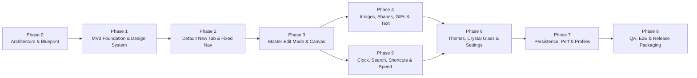

# PHASE 0 — Development Roadmap & Quality Plan

**Product:** AURORA — Your Personal Browser Workspace  
**Delivery Model:** 9 Sequential Phases (Phase 0 – Phase 8)  

---

## Roadmap Overview

---

## Phase 0: Product Planning and Architecture
- **Objectives:** Inspect workspace, validate Chrome MV3 feasibility, establish design tokens, architecture, data models, risks, and ADRs prior to writing application code.
- **Tasks:** Workspace audit; author all 7 `docs/PHASE_0_*.md` deliverables; conduct self-review and obtain explicit user sign-off on unresolved ADRs.
- **Dependencies:** None.
- **Expected Outputs:** 7 comprehensive planning documents in `docs/`.
- **Risks:** Premature implementation before resolving storage/permission trade-offs.
- **Testing Requirements:** Documentation consistency and completeness audit.
- **Acceptance Criteria:** All features, MV3 constraints, and ADRs documented without placeholders.
- **Definition of Done:** User reviews and approves Phase 0 blueprint to unlock Phase 1.

---

## Phase 1: Extension Foundation and Design System
- **Objectives:** Initialize repository, Vite + MV3 build pipeline, strict TypeScript configuration, Tailwind + Royal Crystal tokens, shadcn/ui base primitives refactored to Google Material Symbols, and storage/IDB abstraction layer.
- **Tasks:**
  1. Initialize Git repository, `package.json` (`pnpm`), Vite + CRXJS/multi-entry MV3 build, and strict `tsconfig.json`.
  2. Configure Chrome `manifest.json` (MV3, `newtab` override, minimal permissions: `storage`, `favicon`, `alarms`, plus optional permissions).
  3. Bundle `Inter`, `Manrope`, and `Material Symbols Rounded` WOFF2 fonts locally; implement `<MaterialSymbol />`.
  4. Configure Tailwind + CSS custom properties for Dark/Light Royal Crystal tokens and glassmorphism utilities.
  5. Scaffold `shadcn/ui` primitives replacing all `lucide-react` icons with `<MaterialSymbol />`.
  6. Implement `storageService` (`chrome.storage.local` + Zod validation + migrations) and `assetDb` (`idb`).
- **Dependencies:** Phase 0 approval.
- **Expected Outputs:** Loadable unpacked Chrome extension skeleton displaying Royal Crystal token showcase + unit-tested storage layer.
- **Risks:** CRXJS / Vite MV3 HMR quirks on Windows; accidental inclusion of `lucide-react` or unsafe CSP inline scripts.
- **Testing Requirements:** Vitest unit tests for Zod schemas, storage read/write, and `assetDb` CRUD; build verification loading unpacked `dist/` in Chrome.
- **Acceptance Criteria:** `pnpm build` emits valid MV3 bundle with zero CSP warnings; zero Lucide/FA imports exist in `package.json`.
- **Definition of Done:** Extension loads cleanly in `chrome://extensions`, opens blank Royal Crystal New Tab, and passes Phase 1 unit tests.

---

## Phase 2: Default New Tab UI and Fixed Navigation
- **Objectives:** Build the non-editing View Mode shell, Fixed Top Navigation area, Bookmark drawer/bar, 6-dot Google Apps launcher, Profile shortcut, and isolated Widget Error Boundaries.
- **Tasks:**
  1. Implement Fixed Top Navigation (`Bookmarks`, `Gmail`, `Images`, `Apps` 6-dot popover, `Profile` shortcut) with configurable item visibility and style.
  2. Implement optional Chrome Bookmarks permission opt-in flow (`chrome.permissions.request({ permissions: ['bookmarks'] })`) alongside curated default bookmarks.
  3. Build Canvas Viewport container, Safe Bounds calculation, and `<ElementErrorBoundary>`.
  4. Create initial default `Personal` profile layout skeleton with `EDIT / CUSTOMIZE` and `Settings` entry triggers.
- **Dependencies:** Phase 1.
- **Expected Outputs:** Functional View Mode New Tab shell with responsive top navigation and apps launcher.
- **Risks:** Navigation overlapping canvas elements on small `1280×720` screens.
- **Testing Requirements:** RTL component tests for nav visibility toggles, URL sanitization, and apps drawer keyboard navigation.
- **Acceptance Criteria:** Top nav remains aligned across `1280×720` to `3840×2160`; `Escape` and `Tab` navigate cleanly.
- **Definition of Done:** Default New Tab renders in `< 150ms` with accessible top navigation and zero console errors.

---

## Phase 3: Master Edit Mode and Canvas Engine
- **Objectives:** Implement the core visual studio, coordinate math, transactional draft/save engine, undo/redo history, and all 20 required editing operations.
- **Tasks:**
  1. Implement `editorStore` (Zustand + Immer) separating `savedWorkspace` from `editingDraft`, with Undo/Redo stack (`>= 50` steps) and drag-coalesced history commits.
  2. Build interactive selection overlay: click select, Shift+click multi-select, marquee lasso selection, 8-point resize handles, aspect lock (`Shift`).
  3. Implement drag-and-drop translation (`translate3d` 60fps), Snap-to-Grid, and Magnetic Alignment Guides (`6px` threshold).
  4. Implement Group/Ungroup bounding-box transforms, Lock/Unlock, Z-order controls (Front/Forward/Backward/Back), Align (6 modes), Distribute (H/V), Duplicate, Copy/Paste, Delete, and Keyboard Shortcuts.
  5. Build lazy-loaded Editor Chrome: Top Action Bar (`Save`, `Discard`, `Reset`), Floating Contextual Toolbar, Left Layers Panel, and Right Context-Sensitive Properties Inspector.
  6. Implement transactional Save (atomic `chrome.storage.local` commit + multi-tab `onChanged` sync) and Discard (revert + uncommitted blob purge).
- **Dependencies:** Phase 2.
- **Expected Outputs:** Complete interactive Master Edit Mode working across placeholder/base canvas blocks.
- **Risks:** Frame drops during multi-element drag; group resize distortion when children hit min-bounds; accidental stale state across two open New Tabs.
- **Testing Requirements:** Extensive Vitest unit tests for coordinate transformations, alignment/distribution math, group bounds, z-order normalization, and undo/redo; RTL integration tests for Save vs Discard persistence.
- **Acceptance Criteria:** Unsaved edits never appear in a newly opened tab; Saved edits persist across New Tabs and browser restart.
- **Definition of Done:** All 20 editing operations verified via unit + integration tests at 60 fps.

---

## Phase 4: Images, Shapes, GIFs and Text Elements
- **Objectives:** Deliver the rich creative media elements—Shaped Images, Animated GIFs, and Custom Typography Text—with magic-byte security validation and IndexedDB asset management.
- **Tasks:**
  1. Implement `assetValidator` (magic-byte sniffing for PNG, JPEG, WebP, AVIF, GIF87a/89a, WOFF2/WOFF/TTF/OTF; strict size limits).
  2. Build Shaped Image Renderer using SVG `<clipPath>` + crisp vector stroke overlay + outer `drop-shadow` for Square, Rectangle, Circle, Oval, Star, Rounded Rectangle, Diamond, and Custom Corner Geometry.
  3. Build Image Crop/Zoom/Pan inspector controls and optional click actions (`none`, `open-url`, `lightbox`).
  4. Build Animated GIF Renderer storing raw `Blob` -> `ObjectURL` without canvas flattening, plus Pause/Play toggle via frozen-frame canvas overlay and `prefers-reduced-motion` support.
  5. Build Custom Text Renderer (XSS-safe plain text node rendering) with full typography inspector + local `FontFace` uploader & registry.
  6. Implement reference-counted `ObjectURL` cache and Save-time orphan asset garbage collection.
- **Dependencies:** Phase 3.
- **Expected Outputs:** Full creative media pipeline integrated with Master Edit Mode inspector and Layers Panel.
- **Risks:** Memory leaks from unrevoked `ObjectURL`s; large GIF decoding hitches; SVG clipping artifacts on high-DPI monitors.
- **Testing Requirements:** Unit tests for magic-byte validator (spoofed extension rejection), font loader error handling, and orphan GC; Playwright E2E verifying GIF frame preservation across restart.
- **Acceptance Criteria:** Spoofed `.png` containing HTML/script is rejected; uploaded GIF animates smoothly after browser restart; custom `.woff2`/`.ttf` renders accurately.
- **Definition of Done:** Image shapes, GIF preservation, and custom fonts pass unit, integration, and visual verification.

---

## Phase 5: Clock, Search, Shortcuts and Speed Monitor
- **Objectives:** Implement all core functional productivity widgets with performance isolation and strict Chrome MV3 compliance.
- **Tasks:**
  1. Build Live Clock & Date widget (`HH:MM:SS`, `DD/MM/YYYY`, optional weekday, 12/24h, IANA time zones, typography, optional subtle animation) isolated on a 1 Hz aligned leaf timer.
  2. Build Search Bar widget (Google, Bing, DuckDuckGo, Custom `{query}` template, local autocomplete, optional opt-in live suggestions, glass/solid style, `/` & `Ctrl+K` focus shortcuts).
  3. Build Quick Shortcuts widget (single & collection modes, MV3 `_favicon` API + custom icon + Material Symbol + monogram fallback chain, CRUD, duplicate, label toggle).
  4. Build Internet Speed Monitoring Widget + MV3 service worker `chrome.alarms` scheduler: manual trigger, bounded Download/Upload/Latency probes, explicit optional host permission flow, offline/`saveData` handling, honest disclosure UI.
- **Dependencies:** Phase 3.
- **Expected Outputs:** All 4 core functional widgets registered in `widgetRegistry` and editable in Master Edit Mode.
- **Risks:** Clock causing sibling rerenders; `_favicon` failures; speed widget violating bandwidth caps or MV3 alarm limits.
- **Testing Requirements:** React Profiler test asserting 1 Hz clock tick does not rerender siblings; unit tests for URL sanitization, favicon fallback, and speed throughput math; mocked network tests for offline/timeout/error states.
- **Acceptance Criteria:** Zero simulated speed numbers; broken favicon displays clean monogram; search submits valid encoded queries with zero default host permissions.
- **Definition of Done:** All 4 widgets operate reliably in View and Edit modes and pass automated tests.

---

## Phase 6: Themes, Transparency and Customization
- **Objectives:** Complete the Royal Crystal styling engine, Wallpaper customization pipeline, Wallpaper-Adaptive Palette extractor, and 10-category Settings Drawer.
- **Tasks:**
  1. Build Wallpaper uploader/selector (solid, gradient, custom image, `cover`/`contain`/`fill`, position, blur, dim, tinted overlay).
  2. Implement offscreen Canvas color quantization + WCAG luminance calculator for Wallpaper-Adaptive Palette and automatic contrast protection.
  3. Implement Dark, Light, System (`prefers-color-scheme`), Custom Accent, and configurable Crystal Glass opacity/blur/saturation tokens + fallback for disabled backdrop-filter.
  4. Build the 10-category Settings UI (`Appearance`, `Wallpaper`, `Layout`, `Widgets`, `Search`, `Typography`, `Navigation`, `Animations`, `Storage`, `Advanced`).
- **Dependencies:** Phases 4 & 5.
- **Expected Outputs:** Complete personalization engine and Settings UI.
- **Risks:** Contrast failures over bright custom wallpapers; expensive live blur slider lag during adjustment.
- **Testing Requirements:** Unit tests for luminance/contrast derivation; RTL tests for all 10 Settings sections and theme persistence.
- **Acceptance Criteria:** Switching Dark/Light/System/Custom Accent updates all widgets cleanly with zero contrast regressions.
- **Definition of Done:** Theme engine and Settings UI pass accessibility and contrast checks.

---

## Phase 7: Persistence, Performance, Profiles & Portability
- **Objectives:** Deliver multi-profile management, Export/Import bundles, storage diagnostics, crash-recovery safeguards, and performance optimization.
- **Tasks:**
  1. Implement 5 starter profile presets (`Personal`, `Work`, `Study`, `Minimal`, `Creative`) + Create, Rename, Duplicate, Switch, Delete profile workflows.
  2. Implement `.aurora.json` (layout/settings) and `.aurora-bundle.zip` (optional embedded assets) Export/Import with strict Zod validation and size guards.
  3. Build Storage Inspector in Settings showing per-category usage (`IndexedDB` + `chrome.storage.local`) and manual Orphan Cleanup / Factory Reset.
  4. Profile startup render path, code-split Editor & Settings chunks, optimize image decoding (`decoding="async"`), verify zero memory leaks across tab open/close loops.
- **Dependencies:** Phase 6.
- **Expected Outputs:** Production-hardened multi-profile workspace with backup/restore and verified performance budgets.
- **Risks:** Import of corrupted or oversized zip bundles exhausting memory; multi-profile asset GC accidentally deleting assets used by an inactive profile.
- **Testing Requirements:** Unit tests verifying cross-profile orphan GC preserves assets referenced by *any* profile; corrupt import rejection tests; performance trace verification.
- **Acceptance Criteria:** Warm New Tab loads in `< 150 ms`; importing a valid profile restores layout cleanly; deleting one profile never deletes assets still used by another profile.
- **Definition of Done:** Performance targets met and verified; backup/restore rock solid.

---

## Phase 8: QA, Browser E2E Testing, CI & Release Packaging
- **Objectives:** Execute full end-to-end automated verification in real Chromium with unpacked extension loading, configure GitHub Actions CI, accessibility audit, and package release artifacts.
- **Tasks:**
  1. Implement full Playwright E2E suite testing persistent Chromium context with `--load-extension=./dist` covering all 18 required user flows (install, New Tab, wallpaper, image + shape, GIF preservation across restart, custom text + font, shortcuts, Master Edit Mode move/resize/group/ungroup/save, second New Tab persistence, browser restart simulation via persistent context relaunch, profile switch, light/dark themes, error/discard recovery).
  2. Run axe-core / Playwright accessibility checks and keyboard-only navigation audit.
  3. Configure `.github/workflows/ci.yml`: `pnpm lint`, `pnpm typecheck`, `pnpm test:unit`, `pnpm build`, and `pnpm test:e2e` (headless/xvfb Chromium extension run).
  4. Produce release `.zip` archive, Store listing checklist, and final QA sign-off report.
- **Dependencies:** Phase 7.
- **Expected Outputs:** Green CI pipeline, passing E2E suite, Chrome Web Store-ready `.zip` package.
- **Risks:** Playwright Chromium extension loading differences in headless vs headed CI environments (`--headless=new` support).
- **Testing Requirements:** All 18 Playwright E2E scenarios passing deterministically in CI.
- **Acceptance Criteria:** Zero P0/P1 bugs, zero CSP violations, 100% pass rate on Unit, Integration, and E2E suites.
- **Definition of Done:** Clean CI build and verified release artifact ready for Chrome Web Store submission.

